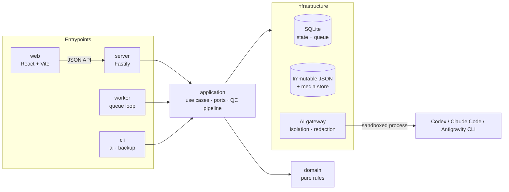

# English AI Platform

[](https://github.com/tnKiness/english-ai-platform/actions/workflows/ci.yml)


A local-first **IELTS learning system** that uses AI to build study material and give feedback — designed so the AI can never see answer keys it shouldn't, never leak credentials, and never claim a band score it can't justify.

It runs on the learner's own machine (Windows), stores everything in SQLite + immutable JSON, and talks to AI through the **CLI tools of existing subscriptions** (Codex, Claude Code, Antigravity) instead of paid API keys — behind a gateway that blocks every provider until its isolation has been proven.

> **Status:** in active development. Foundation (P0–P1) done. AI content pipeline (P2) done: Codex passed provider verification and ran QC1–QC4 on a synthetic package. Learning slice (P3) done on synthetic content: Writing loop, tiered hints, Reading with blind-solved keys, local audio samples. Band scores and speech assessment stay **off** until their policies and content rights are settled (D-02, D-05, D-06). Detailed Vietnamese docs: [docs/README.vi.md](docs/README.vi.md).

---

## Highlights

- **Modular monolith with enforced layering** — `domain` (pure rules, no I/O) → `application` (use cases, ports) → `infrastructure` (SQLite, files, AI) → `server` / `worker` / `web` entrypoints.
- **Durable job queue on SQLite** with leases, fencing tokens, retry budgets and crash recovery ([job-queue.ts](src/infrastructure/sqlite/job-queue.ts), [jobs/state.ts](src/domain/jobs/state.ts)).
- **AI gateway with defense in depth** — env-var allowlist, sandboxed working directory, output redaction, per-provider read-boundary probes; a provider stays blocked until evidence proves it can't read outside its sandbox ([gateway/](src/infrastructure/ai/gateway)).
- **Blind context** — the model only gets the data its task is allowed to see; hidden answer keys are kept out of prompts and out of the web DTOs ([blind-context.ts](src/application/context/blind-context.ts)).
- **Content pipeline: Builder → QC1–QC4 → release gate**, with source-rights tracking, novelty/coverage checks and revocation ([domain/knowledge/](src/domain/knowledge)).
- **Versioned contracts** — JSON Schema for every job, AI result and knowledge pack ([contracts/](contracts)), sequential SQL migrations ([migrations/](migrations)).
- **Coordinated backup/restore** of DB + JSON + media using SQLite online backup ([backup.ts](src/infrastructure/backup/backup.ts)).
- **Local-only HTTP security** — binds to `127.0.0.1`, session cookies, Origin check and CSRF tokens on every write ([session.ts](src/server/session.ts)).
- **222 tests** (unit, integration, contract, Windows process-tree spikes) all running against synthetic data.

## Architecture



| Layer | Responsibility |
|---|---|
| `src/domain` | Entities, invariants, state machines (attempts, jobs, knowledge release). No imports from other layers. |
| `src/application` | Workflows (Writing loop, assessment submission, QC pipeline), context building, port interfaces. |
| `src/infrastructure` | SQLite repositories and queue, JSON/media stores, AI adapters and gateway, backup. |
| `src/server` · `src/worker` · `src/web` | Composition roots: HTTP API, background worker, React UI (talks to the API only). |

Design decisions are recorded in [docs/engineering/DECISIONS.md](docs/engineering/DECISIONS.md); acceptance criteria per phase live next to it.

## Tech stack

TypeScript (strict) · Node.js 22 · Fastify 5 · React 19 · Vite · SQLite (better-sqlite3) · Ajv / JSON Schema · Vitest · ESLint · GitHub Actions

## Getting started

Requires **Windows** and **Node.js 22.18+** (see [.node-version](.node-version)). No API key or AI login is needed — everything runs on the synthetic `FakeAdapter` by default.

```powershell
npm ci
npm run dev:server   # API on http://127.0.0.1:4317
npm run dev          # UI  on http://127.0.0.1:5173
```

Useful commands:

```powershell
npm run check              # lint → typecheck → tests → build (same as CI)
npm run worker -- --fake   # process queued jobs with the synthetic adapter
npm run ai -- status       # why each AI provider is currently blocked (no model call)
npm run backup -- create   # coordinated DB + JSON + media backup
```

## Project layout

```text
src/            domain · application · infrastructure · server · worker · web · cli
contracts/      JSON Schemas (core, provider, knowledge)
migrations/     sequential SQLite migrations
tests/          unit · integration · contract · spikes · fixtures (synthetic only)
docs/           product design (00–06) and engineering docs (plan, decisions, acceptance)
scripts/        tooling, incl. a relay that hands coding tasks between AI coding CLIs
```

## Roadmap

- [x] **P0** – bootstrap, data contracts v1, Windows/SQLite spikes
- [x] **P1** – migrations, immutable stores, rule engine, job queue, backup/restore
- [ ] **P2** – AI Builder/QC pipeline & gateway *(built; blocked on real-provider verification)*
- [ ] **P3** – learning UI: Writing loop ✅, Reading & audio next
- [ ] Real AI feedback and band estimates (after pedagogy & scoring decisions are approved)

## Author

Built by [@tnKiness](https://github.com/tnKiness). Licensed under the [MIT License](LICENSE).
