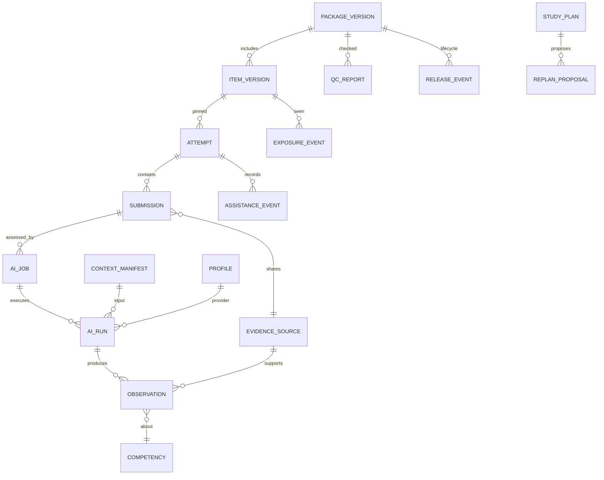

# P0 — Hợp đồng dữ liệu, trạng thái và phục hồi

Ngày: 19/10/2026. Quyết định triển khai E-05; nguồn: 02 §2–5, 04 §2/4/5, 05 §4–6, 06 §5, 06A §5–10. Đây là thiết kế logic và schema v1. **Cập nhật 20/10/2026:** P1 đã hiện thực các bảng, khóa, trạng thái và transaction boundaries dưới đây trong `migrations/0001_core.sql` và `src/infrastructure/sqlite/*` (E-07, [P1_ACCEPTANCE](P1_ACCEPTANCE.md)); attempt/release có persistence, profile và proposal vẫn chỉ là thiết kế.

## ERD logic

Quan hệ trong ERD là đích P1, không khẳng định database đã tồn tại. Job gắn đúng submission/snapshot qua khóa quan hệ P1; schema job P0 giữ attempt + snapshot_version. Rubric/item/knowledge/media là phụ thuộc có phiên bản/hash; cần bảng liên kết đầy đủ ở migration P1, không chỉ một JSON chuỗi không thể truy vấn ngược.

## Danh mục schema
Nguồn máy đọc: [core.v1.schema.json](../../contracts/core.v1.schema.json). Các `$defs`: versionRef, attempt, submission, assistance, exposure, observation, qc, package, release, profile, job, run, manifest, proposal, result. Mọi object từ chối trường thừa. Thời gian phải UTC hậu tố Z; hash SHA-256 dạng hex 64 ký tự. Bản v1 chỉ phục vụ lát cắt P0; loại tác vụ mới cần mở rộng schema có kiểm thử.

Các hợp đồng P0 kiểm tra hình dạng và một số quan hệ nội bộ (original/repair, chất lượng phép đo, task/phase). Chưa kiểm tra quyền thực tế, foreign keys, bằng chứng nguồn, phạm vi đo, QC ngữ nghĩa hay điều kiện READY. Ví dụ `release.state=active` hợp schema không đồng nghĩa được phép phát hành: use case P2 phải kiểm QC đúng hash/phụ thuộc/quyền.

## Định danh và tính bất biến
| Khái niệm | Ý nghĩa / khóa P1 |
|---|---|
| learner attempt | Một lần thực hiện nhiệm vụ đã pin item/rubric; PK attempt_id |
| submission | Bản nộp bất biến; PK submission_id, UNIQUE(attempt_id, revision); original revision 0, bản sửa có parent |
| evidence source | Cùng nguồn bài làm gốc qua sửa/re-evaluation; không nhân số lần độc lập theo observation |
| repair attempt | Tăng khi thực sự nộp sửa; hỏi làm rõ hoặc bộ chấm không chắc không tăng số lần sửa sai |
| hint level | Nấc nội dung đã hiển thị, độc lập với repair count; event idempotency key riêng |
| job | Yêu cầu nghiệp vụ, UNIQUE(idempotency_key); không UNIQUE attempt_id |
| run | Một lần thực thi provider; PK run_id, UNIQUE(job_id, generation); execution_index trong tổng trần 3 |
| observation | PK observation_id; nhiều nhận định/run hợp lệ; khóa chống trùng theo run + mã nhận định ổn định do app cấp, không theo competency đơn lẻ |
| package | UNIQUE(package_id, version), JSON/hash bất biến; lifecycle do SQLite quản lý |
| replan | PK proposal_id; compare-and-set base_plan_version và trạng thái khi xác nhận |

Generation là fencing token tăng mỗi lần cấp quyền thực thi mới/hủy quyền cũ. Việc tăng generation không tự tạo bằng chứng hay bỏ qua tổng execution budget. Lease gồm owner + expiry, không giữ lock DB trong khi chờ model.

## Bảng trạng thái và guard
### Job (đã có hàm kiểm tra cạnh; guard nghiệp vụ/transaction triển khai P1)
| Từ | Đến | Điều kiện và phục hồi |
|---|---|---|
| QUEUED | RUNNING | Claim transaction; còn budget, profile hợp lệ, lease và generation mới |
| QUEUED | WAITING_QUOTA / FAILED / CANCELLED | Hết quota toàn bộ / preflight lỗi không thể chạy / người dùng hủy |
| RUNNING | VALIDATING | Đã nhận output của run hiện hành; kiểm tra schema, provenance, disclosure |
| RUNNING | QUEUED | Lỗi có thể thử lại hoặc lease hết sau crash; generation cũ mất hiệu lực; còn budget |
| RUNNING | WAITING_QUOTA / NEEDS_REVIEW / FAILED / CANCELLED | Theo loại lỗi; REFUSAL không đổi hãng để lách |
| VALIDATING | COMPLETED | Transaction compare generation/lease/state + input version, lưu observations và cập nhật một lần |
| VALIDATING | QUEUED / NEEDS_REVIEW / FAILED / CANCELLED | Sửa schema tối đa một trong trần 3, hoặc chặn/hủy |
| WAITING_QUOTA | QUEUED / CANCELLED | Hạn mức được kiểm tra lại hoặc người dùng yêu cầu; không reset budget |
| trạng thái cuối | Không có cạnh quay lại | COMPLETED/FAILED/CANCELLED/NEEDS_REVIEW giữ lịch sử; xử lý tiếp tạo job mới có liên kết và xét lại budget workflow |

NEEDS_REVIEW là cuối đối với job đó; không tự chạy lại bằng việc đổi state. NEEDS_REVIEW không phải kết luận người học sai. Lease hết tại VALIDATING: bỏ commit cũ, recovery kiểm tra kết quả đã lưu/đã commit; nếu chưa thì cấp generation mới và validation lại hoặc retry trong budget, không đếm lại kết quả đã commit.

### Attempt, profile, release và proposal (thiết kế, chưa có persistence)
| Thực thể | Các chuyển trạng thái | Guard |
|---|---|---|
| Attempt | DRAFT → SUBMITTED → REPAIRING → AWAITING_VERIFICATION → CLOSED; SUBMITTED có thể đi thẳng AWAITING_VERIFICATION/CLOSED | Rule Engine chọn nhánh theo bằng chứng; pause không đổi kết luận; 7A/7B/9 là attempt mới, không dùng bản sửa làm độc lập |
| Profile | NEEDS_LOGIN → NEEDS_VERIFICATION → READY; READY → BUSY → READY | Chỉ READY khi auth/entitlement/billing/isolation/capability đủ chứng cứ; fake không có READY |
| Profile lỗi | BUSY → COOLDOWN / QUOTA_EXHAUSTED / NEEDS_LOGIN / NEEDS_VERIFICATION; bất kỳ trạng thái → DISABLED | RATE_LIMIT khác quota; reset có chứng cứ hoặc kiểm tra có chủ đích; khôi phục phải qua verification, không tự READY |
| Release | draft → active → suspended / retired; suspended → retired | QC đúng hash, quyền, dependencies và scope; sửa nội dung tạo phiên bản mới, không tự kích hoạt lại bản lỗi; retired là cuối |
| Proposal | PROPOSED → ACCEPTED / REJECTED / EXPIRED / STALE | Xác nhận explicit, chưa hết hạn, plan version khớp trong transaction; thao tác lặp không áp dụng lại |

Trạng thái năng lực vẫn là 6 mức và 4 thành phần Phần 02. Chưa có bảng ngưỡng chuyển mức được kiểm định (D-02); không triển khai ngưỡng mặc định từ fixture.

## Transaction boundaries và recovery P1
1. Submit: lưu revision bất biến, nguồn bằng chứng, snapshot và enqueue job cùng transaction; request key chặn gửi đôi.
2. Claim: chuyển QUEUED → RUNNING, ghi run/generation/lease; commit rồi mới chạy CLI.
3. Complete: compare state/run/generation/lease/snapshot và hiệu lực dependencies; commit kết quả + observations + workflow atomically. Unique violation do retry trả bản đã ghi, không ghi lần hai.
4. Exposure: ghi trước hoặc cùng việc cấp nội dung; request lặp không mất dấu tiếp xúc. Trình duyệt không được nhận nội dung nếu không ghi được sự kiện bắt buộc.
5. Publish/revoke: manifest/hash và lifecycle đồng nhất; cache chỉ đọc active hiện hành, revocation không chờ cache TTL. Khóa version không bỏ qua thu hồi.
6. Crash trước commit: không có hiệu lực từng phần. Crash sau commit trước response: trả lại kết quả cũ theo key. Không mở transaction trong thời gian gọi AI.

## Ma trận quyền context
| Người nhận | Được cấp | Không được cấp |
|---|---|---|
| Người học / blind solver | Đề và resource đã được phép nhìn/nghe | Answer, lời giải, hidden target, lịch sử đáp án, rubric nội bộ làm lộ mục tiêu |
| Verifier | Đề + blind result đã khóa + đáp án/rubric đúng version | Không kế thừa phiên sinh đề; không sửa kho phát hành |
| Assessor | Bài nộp + rubric + snapshots/hỗ trợ liên quan | Credential, quyền ghi DB, holdout; không cần toàn bộ lịch sử người học |
| Repair tutor | Dữ liệu và nấc đang được phép | Gợi ý tương lai/answer ngoài mức tiết lộ |
| Builder dry-run | Dữ liệu thử riêng, theo vai trò/pha | Ghi evidence/hồ sơ learner |

P0 có whitelist projection `blindContext`; chưa có resource loader hay sandbox, vì vậy chưa tuyên bố cô lập đầy đủ. Gợi mở sinh sẵn ở pha assessment lưu server; không đưa toàn bộ gói sang tutor hoặc browser.

## Hợp đồng adapter
Interface nằm ở [provider-adapter.ts](../../src/application/ai/provider-adapter.ts): inspectAuth, inspectEntitlement, readQuotaIfSupported, execute, cancel, normalizeResult. `execute` nhận run_id, job và context manifest; response phải qua normalize + schema và kiểm tra correlation trước commit P1. Không merge kết quả giữa provider. Null quota có source/time thay vì số giả. FakeAdapter luôn synthetic, auth=false, entitlement unverified và không mạng.

## Nguồn kỹ thuật cho spike
- [better-sqlite3 API](https://github.com/WiseLibs/better-sqlite3/blob/master/docs/api.md): transaction và online backup.
- [Node child_process](https://nodejs.org/api/child_process.html): spawn/stdin/process; API đã chạy thử với Node 22.18.0 trên Windows.
- Version dependency được đọc từ npm registry và khóa exact trong package.json/package-lock.json. Không suy tính tương thích chỉ từ tài liệu của bản mới; kết quả test local là bằng chứng phạm vi P0.
